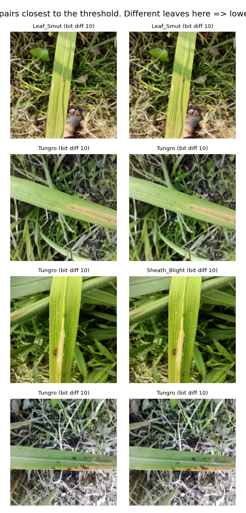
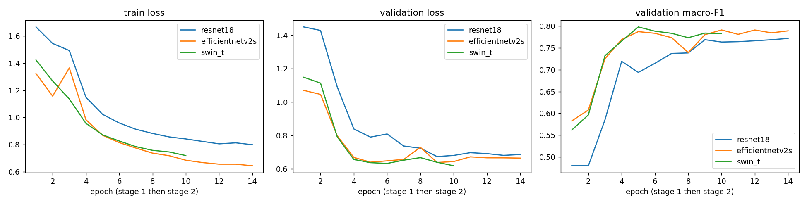
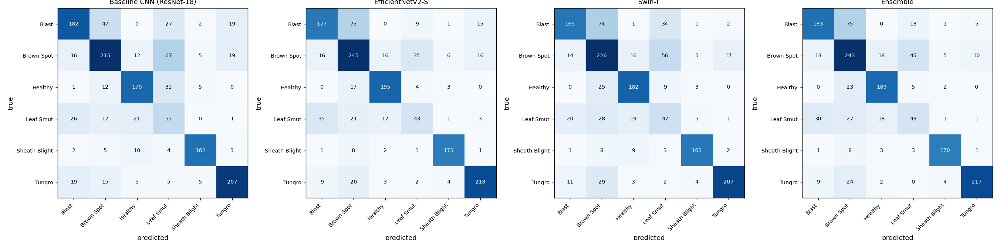
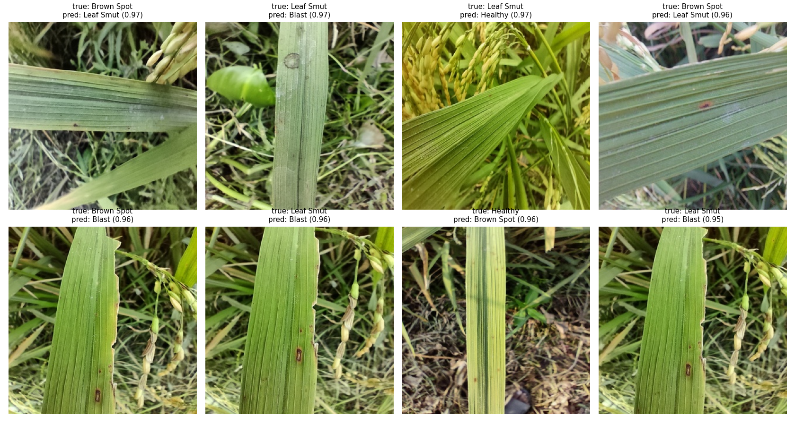
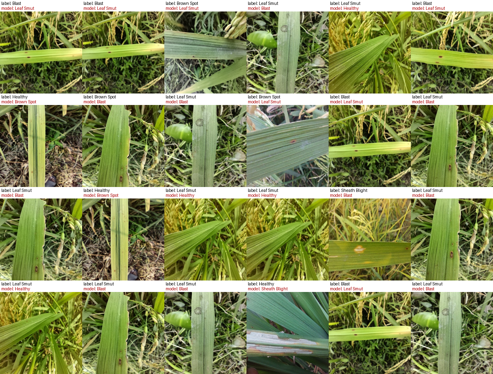
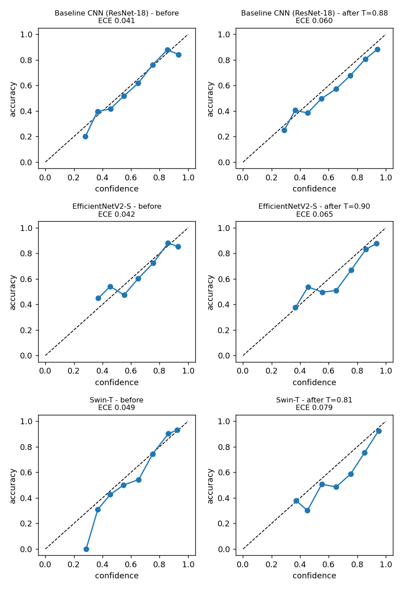
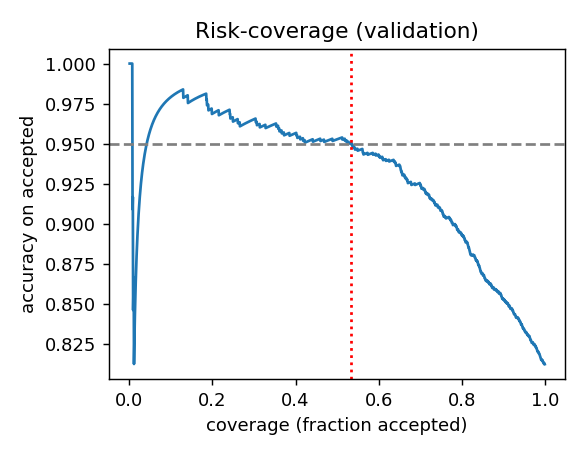

# Rice Leaf Disease Detection with Explainable AI, Severity Estimation and Growth Recommendations

**A decision-support web application (Streamlit + Flask) built on a field-collected smartphone dataset**

Final-year MCA minor project. Author: [[YOUR NAME]]. Guide: [[GUIDE NAME]]. Institution: [[COLLEGE]]. Year: [[YEAR]].

---

## How to use this file (delete this box before submitting)

* Everything below that is marked **MEASURED** was measured on this project's real data and code; the numbers are real.
* Everything marked `[[...]]` is a **placeholder**. It needs a number from your own Colab training run or your own details. **Do not invent these.** The notebook writes them to `outputs/comparison_table.csv`, `outputs/test_metrics.json` and `outputs/figures/`.
* Section 6 (Results) is mostly placeholders on purpose.
* The literature section lists works I know exist, but **I could not open them while writing**. Check every citation, year and venue yourself before submitting. Add the papers your guide expects.
* The Kannada and Hindi text in the app is AI-written and not yet reviewed by a native speaker. The agronomy advice has not been reviewed by an agronomist. Say this in your viva; it is in the Limitations section.

**Placeholder checklist**

| # | Placeholder | Where it comes from |
|---|---|---|
| 1 | ~~Test accuracy, macro precision / recall / F1 for 4 models~~ **filled (Section 6.1)** | |
| 2 | Parameters, model size, CPU ms per image | same file (CPU time is measured on Colab's CPU; re-measure on your laptop) |
| 3 | ~~ECE and temperatures~~ **filled (6.1, 6.4)**; add the reliability-diagram image | `outputs/figures/reliability_diagrams.png` |
| 4 | Confusion matrices, most confused pairs, error analysis text | `outputs/figures/`, notebook section 11 |
| 5 | ~~Rejection thresholds and coverage~~ **filled (6.4)** | |
| 6 | ~~Real-world results on your own phone photos~~ **not performed (decision); stated as a limitation, Section 6.5** | |
| 7 | Your name, guide, college, year, screenshots | you |
| 8 | ~~Colab split table~~ **filled (Section 3.3)** | |

---

## Abstract

Rice is a staple crop, and leaf diseases such as blast, brown spot, tungro and sheath blight reduce yield when they are not recognised early. Many farmers have no quick access to an expert. This project builds a web application in which a user uploads a rice-leaf photo or captures one with the device camera, and receives (1) a disease diagnosis with a calibrated confidence, (2) a heatmap showing which part of the leaf the model used, (3) a rough severity estimate, and (4) disease-specific advice on management and crop care in English, Kannada and Hindi, which can be downloaded as a PDF report.

The classifier is an ensemble of two ImageNet-pretrained networks, EfficientNetV2-S and Swin-T, fine-tuned on RiceLeafDiseaseBD, a dataset of 9,769 smartphone photos taken in Bangladeshi rice fields in six classes (Blast, Brown Spot, Healthy, Leaf Smut, Sheath Blight, Tungro). A small ResNet-18 serves as a baseline. Care was taken to avoid data leakage: byte-identical and conflicting-label images were removed, and photos that are near-duplicates or were taken seconds apart were kept in the same split. Confidence is calibrated by temperature scaling, and the system refuses to answer ("unable to diagnose reliably") when confidence is low or the prediction is too uncertain. On the held-out test split the ensemble reached **75.1%** accuracy and **0.733** macro-F1 (EfficientNetV2-S alone reached 75.5%, so the ensemble gave no measurable gain), and the rejection rule answers about half of the photos at about 93% accuracy. **No field test on our own photographs was performed**, so these figures describe the dataset's own test split (one region, one season) and do not establish accuracy on other fields.

We also report negative findings honestly. A colour-based severity estimator did not separate healthy from diseased leaves on field photos, so it is presented as experimental. The application is a decision-support tool and does not replace an agriculture expert.

**Keywords:** rice disease, deep learning, transfer learning, ensemble, Grad-CAM, calibration, explainable AI, decision support.

---

## 1. Introduction

### 1.1 Background and motivation
Rice leaf diseases are caused by fungi, bacteria and viruses. Several look alike in early stages (for example brown spot and blast both start as small brown spots), and field conditions such as humidity and fertiliser use change how serious they become. A farmer who misidentifies a disease may apply the wrong treatment, spray unnecessarily, or act too late. Expert advice from agriculture officers or Krishi Vigyan Kendras (KVKs) is reliable but not always immediately available.

### 1.2 Problem statement
To build an accessible tool that, from one photograph of a rice leaf, (a) says which of a set of common diseases is most likely, (b) says when it cannot tell, (c) shows evidence for its answer, and (d) gives understandable next steps in local languages, while being clear about its limits.

### 1.3 Objectives
1. Train and compare a baseline CNN, EfficientNetV2-S and Swin-T, and combine the last two into an ensemble.
2. Prevent data leakage and evaluate honestly on an untouched test split.
3. Calibrate the confidence and reject unreliable predictions.
4. Explain predictions with Grad-CAM and estimate severity from lesion colour.
5. Provide sourced management and growth advice in English, Kannada and Hindi, and a downloadable PDF report.
6. Build a responsive web interface with a separate backend API.

### 1.4 Scope
Six classes from one dataset (one region, one season). Local use (no cloud deployment). Photos of a single leaf. The tool supports, but does not replace, expert diagnosis.

---

## 2. Literature review (points to develop)

> Verify each reference yourself. These are works I believe exist; I could not open them while preparing this file.

1. **Deep learning for plant disease from images.** Early large-scale work trained CNNs on the PlantVillage collection of leaf images and reported very high accuracy (Mohanty, Hughes and Salathé, 2016, *Frontiers in Plant Science*; PlantVillage dataset by Hughes and Salathé, 2015). Point to develop: those images were taken on plain backgrounds under controlled conditions, and the same authors noted that performance dropped when testing on images from other conditions. This is the "lab-to-field gap" and motivates using a field-collected dataset.
2. **Rice-specific datasets and studies.** Many rice studies use small or lab-style image sets, or datasets with pre-augmented copies of the same photo, which can leak between training and test splits. Point to develop: our dataset (Section 3.1) is field-collected, and we explicitly remove duplicates.
3. **Transfer learning and modern architectures.** EfficientNetV2 (Tan and Le, 2021, ICML) is a convolutional network scaled for training speed and accuracy. Swin Transformer (Liu et al., 2021, ICCV) is a vision transformer with shifted windows. Pretraining on ImageNet and fine-tuning is standard when data are limited. Point to develop: why a CNN and a transformer may make different errors, which motivates ensembling.
4. **Explainability.** Grad-CAM (Selvaraju et al., 2017, ICCV) produces a coarse heatmap of the image regions that most influenced a class score. Point to develop: heatmaps can show a model attending to the background instead of the leaf, which is a useful sanity check but not proof of correctness.
5. **Confidence calibration and rejection.** Modern networks are often over-confident (Guo, Pleiss, Sun and Weinberger, 2017, ICML). Temperature scaling is a simple post-hoc fix. Expected calibration error (ECE) summarises calibration. Point to develop: selective prediction (refusing to answer) trades coverage for accuracy.
6. **Severity estimation.** Disease severity is often expressed as percent leaf area affected; the IRRI Standard Evaluation System for rice describes scoring scales. Colour-threshold segmentation is cheap but sensitive to lighting and background. Point to develop: our own negative result (Section 6.6).
7. **Agronomic knowledge sources.** IRRI Rice Knowledge Bank and TNAU Agritech Portal provide disease descriptions and management guidance; ICAR institutes publish regional recommendations. We used these for the advice text (Section 4.7).
8. **Dataset paper.** Munna, M. M. H. et al. (2026), *RiceLeafDiseaseBD: A Field-Based Annotated Smartphone Image Dataset of Healthy and Diseased Rice Leaves from Bangladesh*, Mendeley Data, V3, doi: 10.17632/86s4jzj2m4.3 (CC BY 4.0). This citation is taken from the dataset's own README.

**Research gap this project addresses:** combining a field-collected dataset, leakage-safe evaluation, calibrated rejection, explanation, local-language advice and an honest report of where each component fails, in one usable application.

---

## 3. Data

### 3.1 Dataset (MEASURED from the dataset files)
RiceLeafDiseaseBD: 9,769 photos, 1024 x 1024 pixels, captured with two smartphone models in rice fields in Gazipur, Bangladesh, in summer 2025 (rice varieties BRRI dhan28 and dhan29). Labels were assigned by trained annotators with agricultural experts; they are visual labels, not laboratory-confirmed. No train / validation / test split is provided. We used only the `Original images/` folders, **not** the annotated copies, because those have red boxes drawn on the leaves and a model could learn the boxes instead of the disease.

| Class | Images in dataset |
|---|---:|
| Blast | 1,326 |
| Brown Spot | 2,178 |
| Healthy | 1,575 |
| Leaf Smut | 724 |
| Sheath Blight | 1,722 |
| Tungro | 2,244 |
| **Total** | **9,769** |

The classes are imbalanced (Leaf Smut is 7% of images).

### 3.2 Cleaning (MEASURED)
* Byte-identical files were found by comparing checksums stored in the dataset archive: **39 groups** of identical images, of which **31 groups are within one class** and **8 groups (16 images) carry conflicting class labels** (mostly Tungro versus Sheath Blight).
* Our cleaning keeps one copy of each same-class duplicate (31 removed) and removes all copies of a conflicting-label image (18 removed after re-encoding). **9,769 -> 9,720 images.**
* This is a data-quality finding in itself: the same photograph appears under two different diseases in the published dataset.

### 3.3 Leakage-safe split (MEASURED)
Random splitting would put near-identical photos in both training and test sets and inflate accuracy. We therefore:
1. found near-duplicates with a 256-bit perceptual (difference) hash, also comparing mirrored copies (57 near-duplicate pairs found);
2. grouped photos of the same class taken within 10 seconds of each other, using the capture time recovered from the original phone file names (likely the same leaf or plant) (**2,271 groups; largest group 40 images; 8,776 images are in groups of two or more**);
3. split by group, stratified by class, 70 / 15 / 15 with a fixed seed (42), and verified that **no group appears in two splits**.

| Class | Train | Val | Test | Test share of class |
|---|---:|---:|---:|---:|
| Blast | 810 | 235 | 277 | 21.0% |
| Brown Spot | 1,527 | 315 | 334 | 15.3% |
| Healthy | 1,105 | 249 | 219 | 13.9% |
| Leaf Smut | 464 | 137 | 120 | 16.6% |
| Sheath Blight | 1,276 | 228 | 186 | 11.0% |
| Tungro | 1,707 | 275 | 256 | 11.4% |
| **Total** | **6,889** | **1,439** | **1,392** | |

(Overall 70.9% / 14.8% / 14.3%. These are the numbers from the Colab training run, read from `splits.csv`; **0 groups span two splits**, checked again on this file.)

**The class shares are uneven, and why (MEASURED).** The split is "70/15/15 by group", not by image, and a few groups are large (the largest holds 40 images), so the splitter cannot balance every class exactly. In this run Blast has only 61% of its photos in training but 21% in test, and Sheath Blight has 76% in training but 11% in test. We reproduced the split exactly with scikit-learn 1.5.2 and re-ran it with other random seeds: test shares per class then range from about 11% to 22%, so the unevenness comes from the method and the data, not from a bug. **Consequences:** (1) there is no leakage, but the accuracy figure depends on this particular class mix, so **macro-F1 and the per-class table are the more reliable summary** than overall accuracy; (2) Blast had fewer training photos than its share would suggest, which may have contributed to its modest recall. We did not re-split and retrain, to keep the reported results tied to one documented run.

Imbalance is handled with inverse-frequency class weights computed from the training set only (Leaf Smut 2.47, Blast 1.42, Healthy 1.04, Sheath Blight 0.90, Brown Spot 0.75, Tungro 0.67).

*Figure 1. The photo pairs closest to the near-duplicate threshold (bit difference 10 of 256). Every pair shown is visibly the same leaf, so the threshold is not merging different leaves. The third pair is the same photograph labelled Tungro in one copy and Sheath Blight in the other, an example of the conflicting labels discussed in Section 3.2.*

**Honest limit of the grouping:** two photos of the same leaf taken minutes apart cannot be detected this way, so a small amount of leakage may remain.

---

## 4. Methodology

### 4.1 System architecture
Streamlit front end (single-column, mobile-friendly) -> Flask REST API -> model, quality, Grad-CAM, severity, knowledge-base and PDF modules.

| Endpoint | Purpose |
|---|---|
| `GET /api/health` | server and model status |
| `POST /api/predict` | photo -> diagnosis, top 3, heatmap, severity, quality |
| `GET /api/info` | advice text for a diagnosis, language and severity |
| `GET /api/classes` | disease names in a language |
| `POST /api/report` | photo + result -> PDF |

Session history (date, disease, confidence, severity) is kept in the browser session only. Nothing is stored on the server.

### 4.2 Image preparation and quality check
Every photo (upload or camera) goes through one pipeline: validate the file really is a JPEG or PNG, fix the phone's EXIF rotation, shrink to at most 1024 px, convert to RGB. A quality check then flags **blurry** photos (variance of the Laplacian), **too dark** and **overexposed** photos and asks for a retake.
**MEASURED:** thresholds were chosen from 1,500 real photos: real photos had blur score 99 or higher at the 0.5th percentile and brightness 89-155. Chosen: blurry below 40; too dark below 60 mean brightness; overexposed above 200 mean or more than 10% near-white pixels. These flag 0% of real dataset photos and catch 100% of photos blurred with Gaussian sigma 4 and 99.8% of photos darkened to 35%. **Caveat:** the dataset has almost no bad photos, so these are conservative starting values validated only on artificially damaged copies.

### 4.3 Models and training
Three ImageNet-pretrained networks (from the `timm` library) were fine-tuned in PyTorch on a Colab T4 GPU:

| Model | Role | Input size |
|---|---|---|
| ResNet-18 | baseline CNN | 224 |
| EfficientNetV2-S | ensemble member | 288 |
| Swin-T | ensemble member | 224 |

Two-stage fine-tuning: (1) train only the new classification layer for 2 epochs; (2) train the whole network at a lower learning rate for up to 12 epochs. Mixed precision, AdamW (weight decay 0.01), label smoothing 0.1, warm-up plus cosine learning-rate schedule, gradient clipping at 1.0, early stopping on **validation macro-F1** (patience 5), batch size 32, seed 42; all hyper-parameters are logged to `hyperparameters.json`. The classification layer is initialised with small weights, because the default initialisation for EfficientNet gave oversized outputs (**MEASURED:** standard deviation of the logits 6.6 against about 0.1 for the other two models, and a starting loss of 8.8 instead of about 1.8).
Training-set augmentation only: random resized crop, flips, rotation, brightness / contrast / colour jitter, blur, and a random lighting gradient with white-balance shift to imitate phone photos. Validation and test images are only resized.
The final classifier is the average of the two models' calibrated probabilities (EfficientNetV2-S and Swin-T).

### 4.4 Calibration and rejection
* **Temperature scaling:** a single number per model is fitted on the validation split so that confidence matches accuracy; reported with ECE and reliability diagrams.
* **Rejection:** the system answers "unable to diagnose reliably" if the ensemble's top confidence is below a threshold **or** its normalised entropy is above a limit. The confidence threshold is the lowest value at which accepted validation predictions still reach 95% accuracy (with at least 50% coverage); the entropy limit is the 95th percentile of entropy among correctly classified validation images. Both are chosen on **validation** data only and stored in `calibration.json`. Values: confidence threshold **0.845**, entropy limit **0.683**; on the test set this accepts **50.5%** of photos at **92.7%** accuracy.

### 4.5 Explainability
Grad-CAM heatmaps (`pytorch-grad-cam`) on EfficientNetV2-S show where the model looked, with a plain-language caption. It explains that one model, not the whole ensemble, to keep CPU time low.

### 4.6 Severity estimation
Colour segmentation in HSV space: the largest green region is taken as the leaf, and non-green, coloured pixels inside it are counted as lesion; severity is lesion area divided by leaf area, mapped to Mild (below 10%), Moderate (10-25%) and Severe (above 25%). These cut-offs are our own choice, not an official scale. Validity is discussed in Section 6.6.

### 4.7 Knowledge base and PDF report
Advice (description, symptoms, causes, cultural / organic / chemical management, prevention, nutrient / water / spacing / monitoring) is written per disease and per severity in English, Kannada and Hindi, from IRRI Rice Knowledge Bank and TNAU Agritech Portal pages. **No pesticide doses are given**; every chemical section tells the user to follow the product label and consult the local agriculture officer or KVK, and an automated test enforces the no-dose rule. For Leaf Smut no IRRI or TNAU page was found, so the text uses US university extension sources, and says so.
The PDF includes the photo, heatmap, diagnosis, confidence, top 3, severity, advice, sources, date and disclaimer. Kannada and Devanagari text needs complex-script shaping, which the PDF library does not do, so text is shaped with HarfBuzz and drawn as vector outlines with Noto fonts.

### 4.8 Implementation and testing
Python 3.12, PyTorch, timm, Flask, Streamlit, OpenCV, ReportLab. 130+ automated tests cover the API, image handling, quality check, inference with stand-in models, Grad-CAM, severity on synthetic leaves with known area, knowledge-base completeness in all three languages, PDF generation for every disease in every language, and the Streamlit interface.

---

## 5. Evaluation protocol
* **Test split only** for final numbers; validation for early stopping, temperature, and thresholds.
* Metrics: accuracy; per-class and macro precision / recall / F1; confusion matrix; training curves; parameters; size in MB; CPU time per image.
* Calibration: ECE before and after temperature scaling; reliability diagrams.
* Rejection: coverage and accuracy on accepted photos.
* **No separate field test** was carried out (Section 6.5). Every number below is on the dataset's own test split.

---

## 6. Results

> Fill from your Colab run. Do not edit the numbers to look better.

### 6.1 Model comparison (MEASURED, test split of 1,392 images, Colab T4)
| Model | Accuracy | Macro P | Macro R | Macro F1 | Params (M) | Size (MB) | CPU ms / image* | ECE before | ECE after |
|---|---|---|---|---|---|---|---|---|---|
| Baseline CNN (ResNet-18) | 71.2% | 0.706 | 0.702 | 0.701 | 11.2 | 42.7 | 308 | 0.041 | 0.060 |
| EfficientNetV2-S | **75.5%** | 0.742 | 0.734 | 0.736 | 20.2 | 77.8 | 184 | 0.042 | 0.065 |
| Swin-T | 71.1% | 0.711 | 0.697 | 0.700 | 27.5 | 105.1 | 174 | 0.049 | 0.079 |
| Ensemble (EfficientNetV2-S + Swin-T) | 75.1% | 0.743 | 0.729 | 0.733 | 47.7 | 182.9 | 358 | 0.056 | 0.046 |

\*CPU time measured on Colab's CPU with 2 threads. On the project laptop (AMD Ryzen 5 5500U) the full pipeline took about 1.1 s per photo including heatmap and severity (first photo about 3-5 s while the models warm up); re-measure before quoting.

**Reading the table honestly.**
* **On overall accuracy the ensemble did not beat the best single model**: 75.1% against 75.5% for EfficientNetV2-S alone (paired difference -0.4 points, 95% CI -2.1 to +1.2; McNemar p = 0.58). The two are statistically indistinguishable, while the ensemble is twice as slow and more than twice the size. **But for the rejection use case the ensemble is better**; see Section 6.4.
* EfficientNetV2-S improved on the ResNet-18 baseline by about 4 points (difference +4.3, 95% CI +0.6 to +8.2). Swin-T did not improve on the baseline (-0.1, CI -3.2 to +3.2).

**Confidence intervals (MEASURED, cluster bootstrap).** Photos in a group are not independent, so whole groups were resampled together (2,000 resamples, `scripts/analyze_results.py`). The intervals are wider than a naive calculation would give:

| Model | Accuracy (95% CI) | Macro-F1 (95% CI) |
|---|---|---|
| ResNet-18 | 71.2% (65.6 to 76.8) | 0.701 (0.649 to 0.748) |
| EfficientNetV2-S | 75.5% (69.9 to 80.6) | 0.736 (0.683 to 0.786) |
| Swin-T | 71.1% (65.3 to 76.7) | 0.700 (0.650 to 0.746) |
| Ensemble | 75.1% (69.0 to 80.6) | 0.733 (0.677 to 0.784) |

So the true accuracy of the final system on this kind of data is plausibly anywhere from about 69% to 81%; differences of a point or two between models mean nothing.
* All numbers are on the dataset's own test split (same region and season as training). They are not field accuracy; see 6.5.

*Figure 2. Training loss, validation loss and validation macro-F1 per epoch (stage 1 = classifier only, then stage 2 = whole network).*

**Reading the curves.** Validation macro-F1 levels off at roughly 0.77-0.80 after about 5-9 epochs, and the validation loss is flat (about 0.64-0.69) while training loss keeps falling, so there is no sign of strong over-fitting. Swin-T's curve ends at epoch 10, which appears to be early stopping (best epoch 5). Validation macro-F1 (about 0.79 for the two larger models) is higher than their test macro-F1 (0.73-0.74): validation data was used to pick the best epoch and the rejection thresholds, which makes it mildly optimistic, and the two splits also have different class mixes (Section 3.3). The test figures are the ones to quote. (Read from the figure, not from the training log.)

### 6.2 Per-class results (MEASURED, ensemble, test split)
| Class | Precision | Recall | F1 | Test photos |
|---|---:|---:|---:|---:|
| Sheath Blight | 0.929 | 0.914 | 0.921 | 186 |
| Tungro | 0.927 | 0.848 | 0.886 | 256 |
| Healthy | 0.822 | 0.863 | 0.842 | 219 |
| Blast | 0.775 | 0.661 | 0.713 | 277 |
| Brown Spot | 0.608 | 0.728 | 0.662 | 334 |
| **Leaf Smut** | **0.394** | **0.358** | **0.376** | 120 |

Leaf Smut is clearly the weakest class: it is the rarest class (about 7% of the dataset), and the confusion list below shows it being mistaken for Blast and Brown Spot. Sheath Blight and Tungro are recognised best. Note: this test split came out with different class proportions from a plain 15% share (for example Blast 277 photos, Sheath Blight 186); the group-aware splitting can make class shares uneven. (See Section 3.3 for why the class shares in the test split are uneven.)

### 6.3 Error analysis
**MEASURED (ensemble, test split), most common confusions (count, true -> predicted):** Blast -> Brown Spot 75; Brown Spot -> Leaf Smut 45; Leaf Smut -> Blast 30; Leaf Smut -> Brown Spot 27; Tungro -> Brown Spot 24; Healthy -> Brown Spot 23. So the errors are mostly among the three "brown lesion" classes (Blast, Brown Spot, Leaf Smut), and Brown Spot also absorbs some Tungro and Healthy photos.

**Observation from the most confident mistakes (confidence 0.95-0.97):** several of the photographs show a leaf with no clearly visible lesion, or a healthy-looking leaf labelled as a disease, which points to the label noise and to lesions that are very small after resizing (see below). These are impressions from a handful of images, **not tested conclusions**.

*Figure 3. Confusion matrices on the test split (rows = true class, columns = predicted), for the four models.*

For the ensemble: Blast 183 of 277 correct (75 called Brown Spot, 13 Leaf Smut); Brown Spot 243 of 334 (45 called Leaf Smut, 18 Healthy, 13 Blast); Leaf Smut only 43 of 120 (30 called Blast, 27 Brown Spot, 18 Healthy); Healthy 189 of 219 (23 called Brown Spot); Tungro 217 of 256 (24 called Brown Spot); Sheath Blight 170 of 186. Brown Spot is the class most others are mistaken for.

*Figure 4. The eight most confident wrong predictions on the test split (true label and prediction with confidence).*

**What the most confident mistakes show.** These are the eight worst cases by confidence, not a random sample, so they illustrate rather than measure. In several of them the leaf has no clearly visible lesion (for example two of the "Brown Spot" and "Leaf Smut" images and the "Leaf Smut predicted Healthy" image). More importantly, **three of the eight (bottom-left, bottom-second and bottom-right) appear to show the same leaf, with the same torn edge and hanging panicle, labelled Brown Spot in one photo and Leaf Smut in the other two**. If these are indeed photographs of the same leaf, the dataset itself contains inconsistent labels, and some of the reported "errors" would be label noise rather than model failure. Together with the identical photographs filed under two diseases (Section 3.2) this suggests the labels, which are visual and not laboratory-confirmed, are a significant source of the confusion among the three brown-lesion classes. We did not check the labels with an expert, so this remains a hypothesis.

**Label-noise audit (MEASURED, estimate).** On the 2,831 validation and test photos the models never trained on, a confident-learning analysis (per-class thresholds and a confident joint) estimates that about **13.5%** of the labels look wrong, mostly between Blast, Brown Spot and Leaf Smut (for example 75 "Blast" and 77 "Brown Spot" photos that the models are confident belong to a neighbouring class). 275 photos were flagged (list in `results/analysis/suspect_labels.csv`). **Read this carefully:** (1) it is an estimate that assumes the model's probabilities are roughly calibrated and that label mistakes depend only on the class; (2) a montage of the 24 most suspicious photos (`results/analysis/suspect_labels.png`) shows that the *same few scenes appear repeatedly* (burst shots of one leaf), so the 275 flagged photos correspond to far fewer distinct leaves, and the 13.5% is inflated by that repetition; (3) it was **not confirmed by an expert**, so a flagged photo may be correct and the model wrong. It supports the idea that label noise is a significant part of the confusion among the three brown-lesion classes, but it does not measure it. A related fact: in the capture timeline, 20.6% of consecutive photo pairs taken within 10 seconds carry different class labels (the photographer moved between leaves with different symptoms), which shows how closely mixed the classes are in the field. Other hypotheses not tested: Blast and Brown Spot both begin as small brown spots, Tungro yellowing can resemble other conditions, and lesions can become only a few pixels wide after resizing to 224-288 px.

*Figure 4b. The 24 photos whose given label the models most strongly disagree with (black: given label; red: what the model is confident it should be). The same scenes recur, which is why the flagged count overstates the number of distinct leaves.*

### 6.4 Calibration and rejection (MEASURED)
* **Temperature scaling** found temperatures of 0.90 (EfficientNetV2-S) and 0.81 (Swin-T), slightly below 1, meaning the label-smoothed models were mildly *under*-confident. ECE was already low before scaling (0.04-0.06). After scaling it got slightly **worse** for the single models (for example 0.042 -> 0.065) and **better** for the ensemble (0.056 -> 0.046). Temperature scaling minimises the validation loss, not ECE directly, and ECE on 1,392 images is itself noisy, so this is reported as is.

*Figure 5. Reliability diagrams on the test split before (left) and after (right) temperature scaling. A perfectly calibrated model lies on the dashed diagonal. Bins with few photos are noisy.*

After scaling, the single models' curves sit slightly below the diagonal in the middle confidence range, i.e. slightly over-confident, which is why their ECE rose.

*Figure 6. Accuracy among accepted photos against the share of photos accepted (validation split). The dashed horizontal line is the 95% target and the dotted vertical line the chosen operating point.*

* **Rejection rule** (chosen on the validation split only): answer only if ensemble confidence is at least **0.845** and normalised entropy is at most **0.683**.
  * Validation: coverage 53.4%, accuracy on accepted photos 95.1%, overall accuracy 81.2%.
  * **Test:** coverage **50.5%**, accuracy on accepted photos **92.7%**, and **85.3% of the model's wrong answers were refused**.
* **What this means:** the system gives an answer for about half of the photos and is right about 93% of the time when it does; for the other half it asks for a retake. That is a deliberate safety trade-off, and a limitation: many photos will get "unable to diagnose reliably".
* The accuracy on accepted photos (92.7%) is a little below the 95% target set on validation data, the usual small drop from validation to test.
* **Why the ensemble is kept (MEASURED).** Overall accuracy cannot separate the ensemble from EfficientNetV2-S alone, but a system that refuses unsure photos only needs a model that ranks its own answers well. Among the photos each model is *most* confident about (test split, no thresholds involved), the ensemble is more accurate:

| Share of photos answered | EfficientNetV2-S | Ensemble | Difference (95% CI) |
|---|---:|---:|---|
| 30% | 87.3% | 94.0% | +6.7 points (+2.1 to +11.5), ensemble better |
| 50% | 88.1% | 93.0% | +4.9 points (+1.5 to +8.2), ensemble better |
| 70% | 84.7% | 85.3% | +0.6 points (-1.2 to +2.8), no clear difference |
| 100% | 75.5% | 75.1% | no difference |

At the operating point actually used (about 50% answered) the ensemble is therefore about 5 points more accurate on the photos it answers, which is the reason to accept its extra size and time. (For the single models, the notebook's rule cannot reach 95% accuracy at 50% coverage on validation data and falls back to a looser limit, so their threshold-based numbers are not comparable; the fixed-coverage comparison above is the fair one. Our re-implementation of the rule reproduces the notebook's thresholds for the ensemble: 0.844 / 0.684 against 0.845 / 0.683.)
* **Not measured:** how well the rule refuses images that are not rice leaves, or diseases outside the six classes. The notebook has an optional folder for non-rice photos that was not used. One real example from manual use: a low-resolution web thumbnail of rice panicles with dew drops was refused (confidence 36.6%, both rejection reasons fired), which is the intended behaviour, but a single example is an anecdote, not a measurement.

### 6.5 Real-world (field) test: not performed
We did **not** test the system on photographs of our own, because taking and expert-labelling photographs of diseased rice plants was not possible within this project. We state this plainly rather than substitute images from the internet or other datasets, whose labels and origin we cannot vouch for.

**What this means for the results.** All accuracy figures in Sections 6.1-6.4 come from the dataset's own test split: photographs from the same region (Gazipur, Bangladesh), season (summer 2025), two phones and two rice varieties as the training data, with groups of near-identical photos kept apart. They show how well the model learned this dataset; they do **not** show how it performs on other fields, varieties, phones or lighting, and field accuracy is likely to be lower. The rejection rule ("unable to diagnose reliably") is the system's main protection against this, but we have not measured how well it protects on unseen conditions.

**How a field test would be done (future work).** Photograph 20-30 leaves in the target region (healthy, diseased, and non-rice), have each label confirmed by an agriculture officer or experienced farmer, and score them separately from the dataset test split with the provided script, `scripts/eval_real_photos.py`, which reports accuracy with 95% confidence intervals (with about 25 photos, 22 correct would mean roughly 70% to 96%). The script and a protocol (`docs/TESTING_CHECKLIST.md`, Part A) are included but were not used for results.

### 6.6 Severity estimation: a negative result (MEASURED)
We checked the colour-based severity estimator on field photos against the dataset's hand-drawn lesion boxes.
* Healthy leaves scored a median of about **5% "affected"** (90th percentile about 14%): this is the method's noise floor.
* The correlation between our estimate and the annotated lesion area was about zero (Spearman **-0.04**, 398 photos), and healthy and diseased photos received the same median.
* Three alternative colour rules, a central-leaf restriction and a background-complexity guard did not help.
* Likely reason: most Blast and Brown Spot lesions are tiny (median annotated box about 1.4% of the image), about the size of the noise, and busy backgrounds add false lesions.
* On clean synthetic leaves with known affected area the method measured correctly, so the arithmetic is right; the failure is in separating lesions from background and leaf texture in real photos.
* The application therefore labels severity **experimental**, always shows the overlay of what was counted, and warns that values under about 10% may be noise.

---

## 7. Discussion
* Why report a negative result: it prevents farmers being misled and shows the evaluation was honest. A better approach (Section 9) is to train a lesion detector on the dataset's boxes.
* The same photo appearing under two diseases in a public dataset shows why checking data is part of the method.
* Calibration and rejection matter more in agriculture than raw accuracy: an over-confident wrong answer may lead to wrong spraying.
* **Ensemble gain:** none measurable. EfficientNetV2-S alone (75.5%) matched the ensemble (75.1%) within noise, so the extra model buys better calibration but not accuracy. A CNN and a transformer making different errors is the usual argument for ensembling; here the errors apparently overlap, most likely because the hard cases are label-ambiguous brown-lesion photos that both models find hard.
* **Weakest class:** Leaf Smut (F1 0.38) is the rarest class (about 7% of photos) and is confused with Blast and Brown Spot; the three "brown lesion" classes account for most errors. Possible reasons, not tested: few examples, tiny lesions after resizing to 224-288 px, and visual (not lab-confirmed) labels.
* **What 75% means here:** the rejection rule trades coverage for reliability, answering about half of the photos at about 93% accuracy. For a farmer-facing tool this is the honest operating point: it prefers "retake the photo" to a confident wrong answer.
* **Lab-to-field gap:** not measured by us (Section 6.5). The training data is already field-collected, which should help, but one region, one season and two phones remain.

## 8. Limitations
1. **One region, one season, two phones** (Gazipur, Bangladesh, summer 2025), and **no field test was performed** (Section 6.5). Accuracy on Indian fields is unknown and probably lower than the dataset figures.
2. **Labels are visual**, validated by experts, not laboratory-confirmed, and appear partly inconsistent (a confident-learning estimate puts the share of suspect labels near 13.5%, inflated by repeated shots of the same leaf and unconfirmed by any expert, Section 6.3): identical photographs sit under two diseases (Section 3.2) and the most confident test errors include what looks like the same leaf labelled both Brown Spot and Leaf Smut (Section 6.3). Some of the measured error is therefore probably label noise, which we have not quantified.
3. **Six diseases only.** Other diseases, nutrient deficiency and pest damage will be mapped to the nearest class or rejected; rejection reduces but does not remove this.
4. **Possible residual leakage** between photos of the same plant taken minutes apart.
5. **Severity estimate is experimental** and unreliable on field photos (Section 6.6).
6. **Heatmap** explains one model, not the ensemble, and shows correlation with the decision, not proof of correctness.
7. **Advice text** was written from IRRI and TNAU pages (read through search summaries because direct page access was blocked), has not been reviewed by an agronomist, and may differ by region and year. Leaf Smut advice relies on non-IRRI sources.
8. **Kannada and Hindi text is AI-written** and not yet reviewed by a native speaker. In the PDF, Kannada and Hindi text is not selectable.
9. **Quality thresholds** were set on artificially damaged copies, not on real bad photos.
10. **CPU speed** was measured on Colab's CPU and should be re-measured on the machine used for the demo.
11. **Local use only**; no cloud deployment, user accounts or server-side storage.
12. A decision-support tool: **it does not replace an agriculture expert**.

## 9. Future work
* **A field test** with 20-30 expert-labelled photographs from the target region (protocol and scoring script already provided), reported separately from the dataset test split.
* Train a lesion detector on the dataset's YOLO boxes for count and area-based severity (the dataset is designed for this).
* Add field photos from Karnataka and fine-tune; report before and after.
* Add more diseases (for example bacterial leaf blight) and a "nutrient deficiency" class.
* Review of advice by agriculture officers; native-speaker review of translations.
* Explain the full ensemble; add uncertainty from multiple models.
* Quantisation or ONNX for faster CPU inference; optional cloud deployment with HTTPS for phone camera use.
* On-device or offline mode for areas with poor connectivity.

## 10. Conclusion
We built and evaluated a complete rice-leaf diagnosis assistant around a leakage-safe training pipeline, a calibrated two-model ensemble that can say "I am not sure", explanations, sourced advice in three languages and a PDF report. The ensemble reached 75.1% on the held-out split (no better than EfficientNetV2-S alone at 75.5%); no field test was performed, so accuracy on other fields remains to be measured. We found and report data-quality problems in the public dataset and a negative result for colour-based severity. The tool supports decisions; it does not replace an agriculture expert.

---

## References (verify every entry before submitting)
1. Munna, M. M. H. et al. (2026). RiceLeafDiseaseBD: A Field-Based Annotated Smartphone Image Dataset of Healthy and Diseased Rice Leaves from Bangladesh. Mendeley Data, V3. doi: 10.17632/86s4jzj2m4.3.
2. Tan, M., Le, Q. (2021). EfficientNetV2: Smaller Models and Faster Training. ICML.
3. Liu, Z. et al. (2021). Swin Transformer: Hierarchical Vision Transformer using Shifted Windows. ICCV.
4. Selvaraju, R. R. et al. (2017). Grad-CAM: Visual Explanations from Deep Networks via Gradient-based Localization. ICCV.
5. Guo, C., Pleiss, G., Sun, Y., Weinberger, K. Q. (2017). On Calibration of Modern Neural Networks. ICML.
6. Mohanty, S. P., Hughes, D. P., Salathé, M. (2016). Using Deep Learning for Image-Based Plant Disease Detection. Frontiers in Plant Science.
7. Hughes, D. P., Salathé, M. (2015). An open access repository of images on plant health to enable the development of mobile disease diagnostics (PlantVillage).
8. Wightman, R. PyTorch Image Models (timm). GitHub repository.
9. IRRI Rice Knowledge Bank: Brown spot; Blast (leaf and collar); Blast (node and neck); Tungro; Green leafhopper; Sheath blight; Nitrogen excess; Alternate wetting and drying. knowledgebank.irri.org.
10. TNAU Agritech Portal: Blast; Brown spot; Tungro; Sheath blight; Management of diseases of important agricultural crops of Tamil Nadu. agritech.tnau.ac.in.
11. Texas A&M Plant Disease Handbook (Rice); University of Arkansas Division of Agriculture, Rice disease management (for Leaf Smut).
12. IRRI. Standard Evaluation System for Rice.

Software: PyTorch, torchvision, timm, pytorch-grad-cam, OpenCV, Flask, Streamlit, ReportLab, HarfBuzz (uharfbuzz), fontTools; fonts Noto Sans, Noto Sans Kannada, Noto Sans Devanagari (SIL Open Font License).
